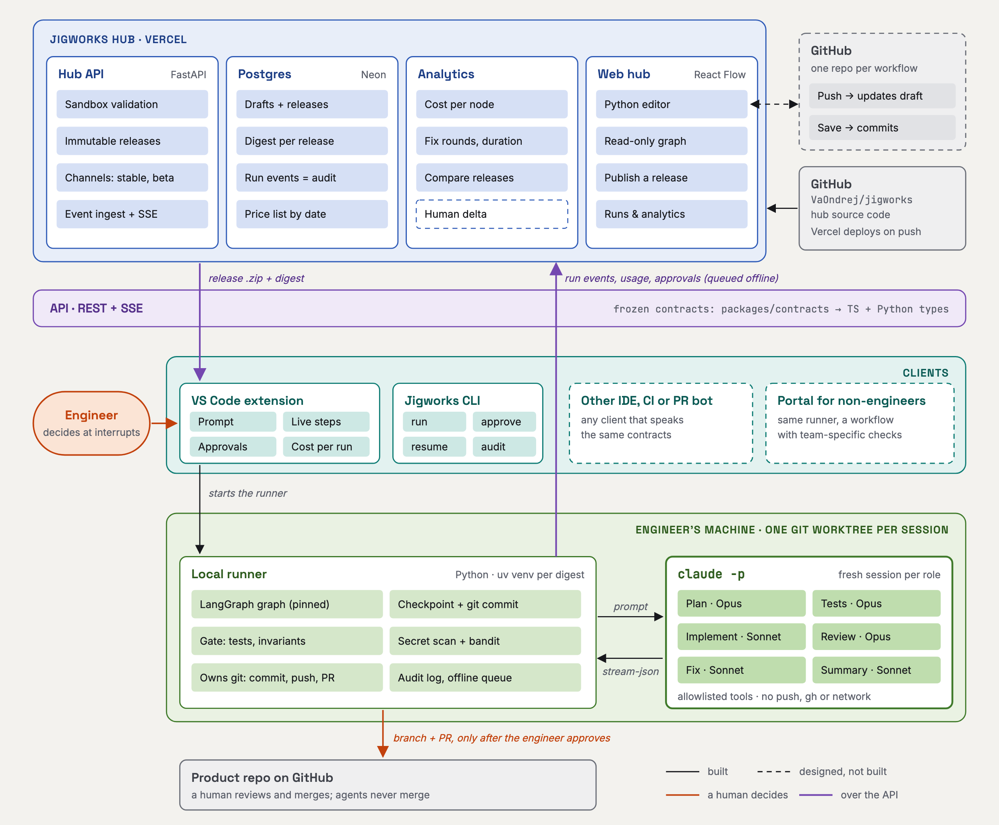
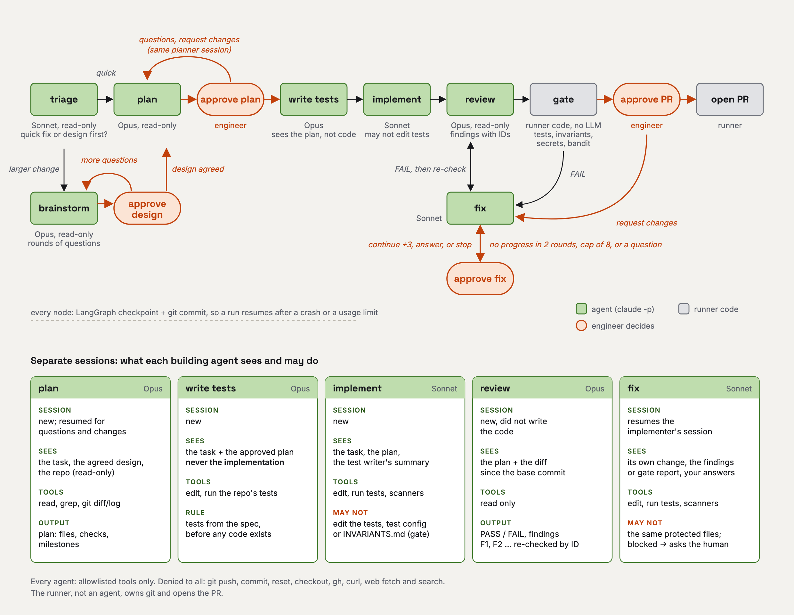

# Jigworks

A software factory prototype for the case study "Design Your Software Factory" (AI Engineer,
FTMO & OANDA).

## Why "Jigworks"

The name comes from real jig works: the workshops that build jigs and fixtures for manufacturing.
A jig holds the part and guides the tool, so every hole and every cut lands in exactly the same
place, with surgical precision, no matter who runs the machine. Skill goes into the jig once, and
every part made with it comes out the same.

Jigworks is that workshop for AI coding agents. The jig is a **versioned workflow**: Python
LangGraph code with its prompts, models, skills and tool rules. It is built and published once in
the hub, guides the agent the same way on every engineer's machine, stops where a person must
decide, and leaves an audit trail and analytics behind every run, so the jig itself can be made
more precise release by release.

**Start here: [my answers to the nine questions](docs/case-study-answers.md).**



## What is built and what is only designed

| Built and running | Designed, not built |
|---|---|
| `feature-development` workflow: triage, brainstorming, plan agreed with the human, tests by a separate agent, implement, independent review, fix rounds that stop for the human, gate (tests, property tests, secret scan, bandit), approval, PR | Human delta: storing what people change after the AI and learning from it |
| Local runner: checkpoint + git commit per node, resume after a crash or a limit, upgrade of a waiting run to a newer release, audit log | One GitHub repo per workflow, synced with the hub's Python editor (the hub app itself already deploys from this repo through Vercel) |
| VS Code extension: parallel sessions in worktrees, live steps and agent output, approvals, cost | Portal and department workflows for non-engineers |
| Hub on Vercel: Python editor, read-only graph, immutable releases and channels, run events, cost and analytics per release | Central sandboxes and service credentials instead of laptops |
| Evals on a synthetic order-handling service whose invariants are guarded by property tests | Live A/B evals of a release against a plain agent session |

A real run of the workflow built [PR #13](https://github.com/VaOndrej/jigworks/pull/13): a
BTC/USD paper-trading exchange in [`demo/btc-paper-trader/`](demo/btc-paper-trader/README.md).
What went wrong in that run became releases 1.7.0 and 1.8.0 of the workflow.



## Try it

| What | How |
|---|---|
| Hub | <https://jigworks.vercel.app>; the password is in the e-mail that came with this repo |
| VS Code extension | [docs/guide-vscode-extension.md](docs/guide-vscode-extension.md) (about 10 minutes). Or open the repo in Claude Code and ask: "Read docs/guide-vscode-extension.md and install and connect the Jigworks extension for me." |
| Jigworks CLI | `uv sync`, then `uv run jigworks --help` |
| Demo exchange | `cd demo && uv sync && uv run btc-paper-trader --bots 1000` |
| Evals (scripted agents, free) | `uv run python -m workflows.feature_development.evals.run --adapter fake` |
| Tests | `uv run pytest -q` (≈ 6 min), `cd demo && uv run pytest -q`, `pnpm -r test` |

Real runs need Claude Code installed and logged in (`claude -p`); auth belongs to Claude Code,
not to Jigworks.

## How to read the repo

1. [docs/case-study-answers.md](docs/case-study-answers.md): the answers to the brief.
2. [docs/design.md](docs/design.md): the design and the decisions behind it.
3. [workflows/feature-development/](workflows/feature-development/README.md): the workflow
   (`graph.py`, `steps/`, `prompts/`, `workflow.toml`) and its
   [eval results](workflows/feature-development/evals/results/2026-11-19-fake.md).
4. [BUILD_LOG.md](BUILD_LOG.md): my time vs agent time, what I delegated, reviewed and wrote,
   and what went wrong.
5. How it was built with agents: [AGENTS.md](AGENTS.md) (the instructions every agent followed),
   [docs/plan.md](docs/plan.md) and [tickets/](tickets/prototype/) (one ticket per change, with
   evidence), [docs/two-agent-build.md](docs/two-agent-build.md) (the overnight build with two
   agents in parallel), and the review notes in `docs/foundation-review.md` and
   `docs/morning-review.md`.

## Repo map

```
apps/hub-api/        FastAPI hub API (Python)
apps/hub-web/        hub web app (Vite, React, React Flow)
clients/vscode/      VS Code extension
runner/              local runner and the claude -p adapter (Python)
packages/contracts/  event and API schemas → TS + Python types
workflows/           the feature-development workflow package and its evals
sample-repo/         synthetic order-handling service with invariants
demo/                the app the workflow built (PR #13)
e2e/                 Playwright checks and screenshots
docs/                design, answers, plan, guides, diagrams
tickets/             one Markdown file per ticket
```

Public or synthetic data only. License: [FSL-1.1-ALv2](LICENSE.md).
