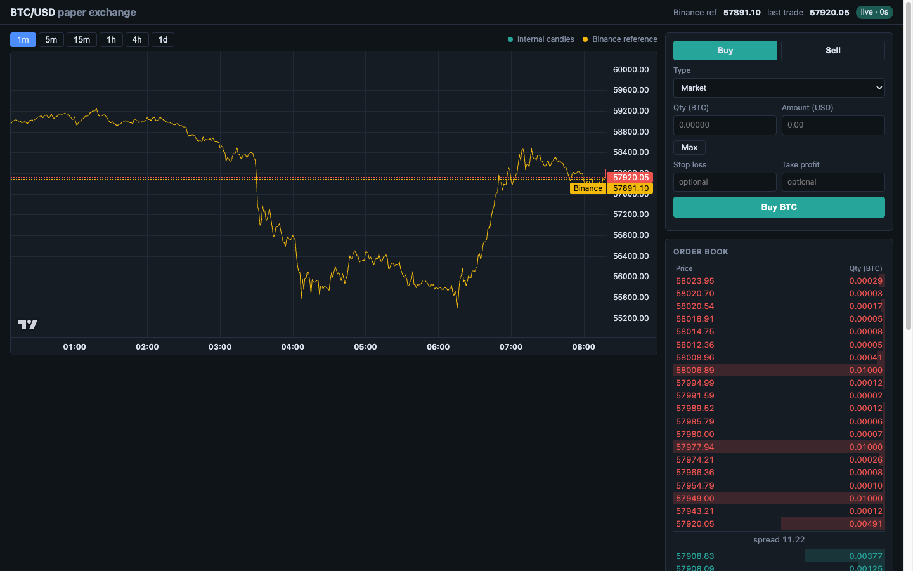

# btc-paper-trader

A local, simulated spot exchange for **BTC/USD**. Many anonymous traders start with $100 of play
money each and trade against each other in one real internal order book. 1,000 seeded bots and a
house market maker provide the liquidity; Binance `BTCUSDT` (or a deterministic sim feed) supplies
only the reference price. You trade in the browser as one real user.

* Spot only, long only, buy and sell. No shorts, no leverage, no liquidation.
* Backend: Python 3.12, fully async (FastAPI + uvicorn, one asyncio event loop).
* Local only: it binds to `127.0.0.1` (there is no flag to change that). No secrets, no API keys.
* Everything is `Decimal`; every balance is conserved (global USD and BTC totals are exactly 0
  against the treasury).



## Run

You need [uv](https://docs.astral.sh/uv/getting-started/installation/) (it fetches Python 3.12
itself if you do not have it). Nothing else: no Node, no Docker, no API keys. Start from the root
of a fresh clone:

```
cd demo
uv sync                                      # creates demo/.venv with the app and its dependencies
uv run btc-paper-trader --bots 1000          # opens http://127.0.0.1:8000 in your browser
```

That is all. Within a few seconds the status badge in the top right turns `live`, the chart shows
the Binance BTCUSDT price and the order book fills with bot orders. Trade with the ticket on the
right; your browser gets its own $100 account. Stop the server with `Ctrl+C`.

Variants:

```
uv run btc-paper-trader --feed sim --seed 7 --bots 1000   # no network: a seeded random-walk price
uv run btc-paper-trader --port 8001 --no-browser          # another port, do not open a browser
```

State (accounts, orders, trades) is kept in `btc-paper-trader/data/exchange.db` (ignored by git)
and survives a restart. To start from scratch, stop the server and delete that file.

If the page shows `stale` and orders are rejected, the Binance feed is unreachable from your
network; use `--feed sim`. If port 8000 is taken, pass `--port`.

| Flag | Default | |
|---|---|---|
| `--feed binance\|sim` | `binance` | reference price source |
| `--seed N` | `0` | seed for the sim feed and the bots |
| `--port N` | `8000` | |
| `--db PATH` | `btc-paper-trader/data/exchange.db` | SQLite file; state survives a restart |
| `--bots N` | `0` | in-process bots, $100 each |
| `--no-browser` | off | do not open the browser |
| `--binance-base URL` | `https://api.binance.com` | REST base; falls back to `https://data-api.binance.vision` |
| `--sim-tick-ms N` | `500` | sim feed tick period |
| `--house-usd`, `--house-btc` | `200000`, `2` | house inventory, issued once on the first start, never topped up |
| `--house-levels`, `--house-spread-bps` | `10`, `10` | house ladder |

Binance history comes from REST klines; live data from the combined kline WebSocket (a 1m kline
update is a reference tick, about every 2 s). The feed reconnects with backoff 1 s to 30 s and
refetches history each time. After more than 10 s without a tick the status is `stale`, new orders
get `422 stale_reference` and cancels still work.

Logs: one JSON line on stdout per order event, feed connect / disconnect / stale / reconnect, and
account reset (written from a background thread).

## How the exchange works

* **Accounts:** an anonymous `account_id` cookie lazily creates exactly one $100 account. Reset
  affects only that account.
* **Book:** price levels with FIFO queues, price-time priority, partial fills. Users, bots and the
  house share one book with no special priority.
* **Orders:** market, limit, stop; `reduce_only`; SL/TP from the ticket as child orders; cancel.
  Market orders walk the book inside a +-5% band around the reference price and cancel the rest.
  Stops trigger on the internal last trade and then enter as market orders.
* **Reservations and fees:** an open buy reserves price x qty + max fee, an open sell reserves its
  BTC. Fees are `ceil_usd(qty x price x rate)`: maker 0.05%, taker 0.1%, paid to a fee account.
* **Rejections** return `422` with a `reason` and appear in the order history.

`INVARIANTS.md` maps every invariant (1-18) and every async quality rule (A1-A7) to its test.

## Async model

* **One loop, structured concurrency.** `Service.running()` owns one `asyncio.TaskGroup`. Its children
  are the exchange task, the feed, the bot scheduler, the stale watchdog, the loop-lag monitor and the
  book throttle. uvicorn runs in the same loop. Threads exist only inside `aiosqlite`, the log
  listener and `webbrowser.open`.
* **Single writer, no locks.** Exchange state is mutated only inside `ExchangeTask`. Producers
  (HTTP, bots, the feed) enqueue a command and await its future. Reads (`/api/book`, `/api/state`)
  happen synchronously between awaits.
* **Group commit.** The task takes the first command, drains up to 500 more, applies them to the
  pure synchronous `matching.Engine`, then commits **one** SQLite transaction for the batch before it
  resolves the futures and publishes events.
* **Back-pressure.** The command queue holds 10,000; handlers use a 5 s timeout and answer
  `503 overloaded`. Bots use `put_nowait` and skip their action when the queue is full.
* **Bounded fan-out.** Each WebSocket client has its own bounded queue and writer task.
  `Broadcaster.publish` is synchronous and never awaits. `book`, `reference` and `candle` messages
  coalesce to the newest, `trade` keeps the newest 100, `fill` and `state` are never dropped (more
  than 1,000 waiting closes the socket with 1013). Messages are JSON-encoded once, not per client,
  and a client writer batches for 0.1 s (a few clients) up to 0.4 s (1,000 clients). Every queued
  trade is delivered, except that with more than 250 connected sockets only the newest trade of a
  batch is sent (delivering all of them to 1,000 clients measured 1.1 s of loop lag).
* **Shutdown.** Producers stop, the queue is drained and the last batch committed, then the rest is
  cancelled and the store closed. A failed commit stops the process with exit code 1.
* **Loop lag** is measured by a 50 ms heartbeat and shown in `/healthz` (`loop_lag_ms.max` / `p99`).

## API

`GET /`, `GET /healthz`, `GET /api/reference/candles?tf=`, `GET /api/candles?tf=`,
`GET /api/book?depth=20`, `GET /api/trades?limit=100`, `GET /api/state`, `POST /api/orders`,
`DELETE /api/orders/{id}` (another account's id is a 404), `POST /api/position/close`,
`POST /api/account/reset`, `GET /api/internal/totals`, `WS /ws` (send
`{"type":"subscribe","tf":"1m"}`; receive `trade`, `book`, `candle`, `reference`, plus `fill` and
`state` for your own account).

## Tests

Gate (no network, no browser):

```
cd demo && uv run pytest -q -p no:cacheprovider
```

Opt-in suites (run them yourself):

```
# e2e: Playwright at 1440 px, 50 bots; screenshots go to btc-paper-trader/tests/e2e/screenshots/
cd demo && uv run playwright install chromium && BTC_E2E=1 uv run pytest -q -p no:cacheprovider -m e2e

# load: 1,000 HTTP + WebSocket clients against uvicorn with --feed sim --bots 1000
# (the test process needs about 1,100 open files; the shell default on macOS is 256)
cd demo && ulimit -n 4096 && BTC_LOAD=1 uv run pytest -q -p no:cacheprovider -m load -s
```

`BTC_LOAD_SECONDS` (default 60) sets the load duration.

## Load results

Measured on 20 Nov 2026 on the development laptop (macOS, Python 3.12, uvloop), server and 1,000
test clients on the same machine, `BTC_LOAD_SECONDS=60`. Latencies: p95 order to ack is measured by
the client; tick to push is the client receipt time minus the server's `tick_ts`. The tick to push
number includes the client writer's batching period (up to 0.4 s at 1,000 clients). Numbers are
reported only; there is no threshold.

| clients | bots | seconds | orders | 503 overloaded | p95 order->ack ms | p95 tick->push ms | loop lag max ms | loop lag p99 ms |
|---|---|---|---|---|---|---|---|---|
| 1000 | 1000 | 60 | 11993 | 0 | 53.4 | 421.4 | 77.68 | 40.15 |

The same run asserted no 5xx, every client's WebSocket fills equal to its `/api/state` fills, and
`/api/internal/totals` equal to 0 for both USD and BTC. Re-run it on your machine; the numbers
depend on it.

## Charts and attribution

The chart is [TradingView Lightweight Charts](https://www.tradingview.com/lightweight-charts/) v5
(Apache-2.0), vendored in `src/btc_paper_trader/static/vendor/lightweight-charts/` together with its
`LICENSE`, and keeps TradingView's attribution logo. The page footer carries the attribution too.

The library file is committed, so the chart works offline. If it were missing, the page would show
a notice instead of the chart and everything else would still work. To update it, run from the
repository root:

```
D=demo/btc-paper-trader/src/btc_paper_trader/static/vendor/lightweight-charts && mkdir -p "$D" \
  && curl -fsSL https://cdn.jsdelivr.net/npm/lightweight-charts@5/dist/lightweight-charts.standalone.production.js -o "$D/lightweight-charts.standalone.production.js" \
  && curl -fsSL https://cdn.jsdelivr.net/npm/lightweight-charts@5/LICENSE -o "$D/LICENSE" \
  && head -c 200 "$D/lightweight-charts.standalone.production.js"
```

Vendored version: **v5.3.0** (from the file header, 21 Nov 2026).

## Design notes and deliberate trade-offs

* In memory each account keeps its open orders plus its newest 200 finished orders and 200 fills;
  the database keeps everything (internal candles are rebuilt from the full `trades` table at
  startup). House quotes that were cancelled by a requote without a fill are dropped from memory
  *and* the database, because they would otherwise add about 40 rows per tick.
* An order id that belongs to another account, or an unknown id, is a 404 on cancel (the engine
  answers `not_found` in both cases).
* The `reference_price` and its timestamp are persisted, so a restart keeps the book and the
  reference; after a long stop the reference is stale until the first new tick.
* A minimum-notional check ($1) applies to user orders; SL/TP children, clipped orders and the
  close-position order are exempt, so a dust position can always be closed.
