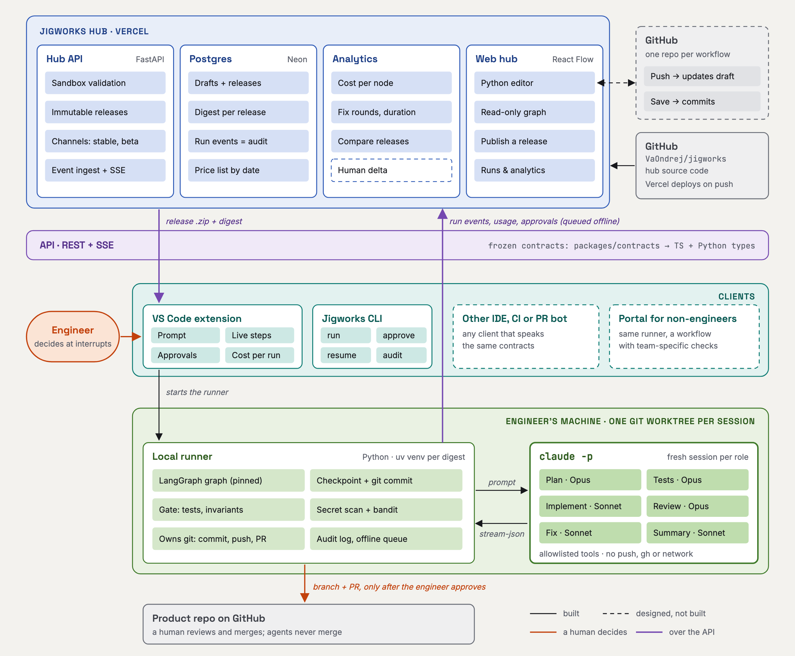
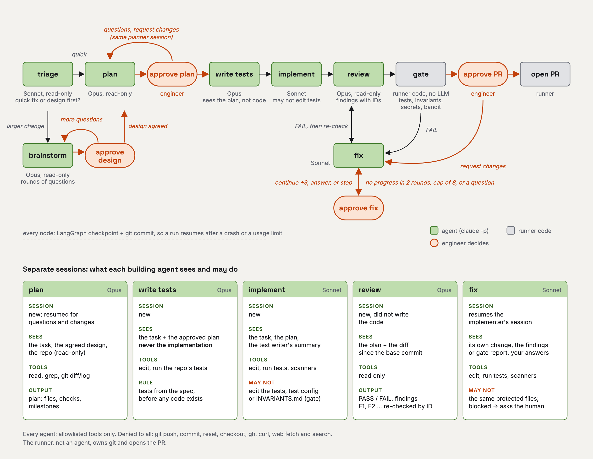

# Design your software factory: my answers

The nine questions from the brief, answered for FTMO & OANDA. Each answer says what is
**built** in this repo and what is only **designed**. The deep dives are Q3 (the harness),
Q5 (delegate, review, own) and Q6 (quality, security and governance). The other answers are short.

## Q1 · Your definition

A software factory is not one clever prompt and not one agent. It is a **way of working that
moves between teams and does not leave with the person who wrote it**. In Jigworks that way of
working is a workflow: ordinary Python code (a LangGraph graph with prompts, models and skills)
that is versioned, published as an immutable release and run the same way by everyone who picks
it. Every run leaves an audit trail and analytics (cost, fix rounds, outcome per release), so
the workflow is improved from measurements, not from feelings.

On the range from "tasks in, shipped changes out" to "how agents talk to each other", Jigworks
sits closer to the first, with one deliberate difference: **a person owns the plan and the
merge**. Agents hand work to each other inside the workflow (planner → test writer →
implementer → reviewer → fixer), but the hand-off protocol is the graph, not a chat between
agents.

It is deliberately **not**:
- an autopilot that merges or deploys on its own,
- a new agent or model (it drives `claude -p`, and other CLIs can follow),
- a replacement for LangGraph, CI or code review (it runs before them and feeds them),
- a policy engine that stops people from using other tools. It makes the governed path the
  easiest one; it cannot enforce it at merge time.

## Q2 · Problems and people

In the order I would solve them:

1. **The senior engineer on the trading platform** ("agents quietly break invariants").
   Invariants are checked by design, not by luck: the tests are written from the agreed spec by a
   different agent before any code exists, the implementer cannot edit them or `INVARIANTS.md`,
   and the gate runs property tests that are plain code, not a model. The output is measurable,
   so after ten tickets run through the factory there is enough data to publish a better
   release, and he can see the improvement in numbers instead of being asked to believe it.
   *Built:* the gate, the protected tests, the property-test evals on `sample-repo/`.
2. **The engineer who runs long tasks** ("agents lose the thread"). The workflow cannot start
   coding before a plan is agreed with the human. Every node ends with a LangGraph checkpoint
   and a git commit, so the run state lives outside the agent's context: a run continues after a
   crash, a killed laptop or a usage limit with `jigworks resume`. The reviewer is a different
   agent from the implementer. *Built.* Splitting a large plan into milestone tickets with a
   review every few tickets is the next step (T23, designed).
3. **The team lead** ("I can't tell whether we're faster", "setups leave with people"). The
   workflow is shared and versioned in the hub instead of living in one person's prompts. The
   analytics show, per release, how long a change takes from the first prompt to the PR, what it
   cost, how many fix rounds it needed and where an engineer had to step in (every approval,
   request for changes and answer is a run event). *Built:* releases, run events, cost and
   duration per release. *Designed:* the human delta (what people change after the AI, Q4).
4. **The security and compliance lead** (audit, approver ≠ author). Every run records who
   started it, the release digest, the models, every step, the changed files, the gate results
   and who approved what and when. See Q6. *Built.*
5. **The platform engineer** (laptops, no record, no cost view). Partly: every agent call runs
   with an allowlist of tools in its own git worktree, the runner owns git, and every token is
   priced. Agents still run on laptops with the engineer's Claude login; central sandboxes and
   service credentials are the next step, not the prototype.

What I would **leave alone for now**:
- **The early adopter's volume.** I would not slow anyone down by rule. When the factory is the
  easiest way to get a PR through review, his PRs get smaller, tested by a second agent and
  gated, without a mandate (Q8).
- **The operations analyst** is real and urgent, but the safe answer needs the engineering path
  to be trusted first. It is designed (Q7), not built.
- **Chat and autocomplete.** They work for the senior engineer and the factory does not compete
  with them.

## Q3 · The design (deep dive)

### The system

The diagram above is the whole system. Solid lines are built, dashed lines are designed.

- **Hub** (Vercel: React web app, FastAPI, Postgres). Workflows are written as Python in the web
  editor, validated in a sandbox and published as immutable releases with a digest and a channel
  (`stable`, `beta`). The hub stores run events, which are the audit trail, and computes the
  analytics from them. It never executes workflow code and never sees CLI credentials. The hub
  app itself is deployed by Vercel from this GitHub repo on every push. *Designed:* each workflow
  gets its own GitHub repo, synced with the hub's Python editor (a push updates the draft, a save
  commits), so workflows are reviewed like any other code.
- **Contracts** (`packages/contracts/`): JSON schemas generated into TypeScript and Python types.
  Any client that speaks them works: the VS Code extension and the Jigworks CLI (`jigworks`) are built;
  another IDE, a CI or PR bot, or a portal for non-engineers would use the same API.
- **VS Code extension**: pick a workflow, write the prompt, watch the steps and the agent output
  live, answer questions, approve or request changes, see the cost per run. Each session runs in
  its own git worktree, so several can run in parallel.
- **Local runner** (Python, one `uv` venv per release digest): runs the LangGraph graph of the
  pinned release, checkpoints and commits after every node, runs the gate, owns git (commit,
  push, PR) and sends events to the hub, queued while offline.
- **Agents**: `claude -p --output-format stream-json`, a fresh session per role, with the models,
  effort and skills set by the release, so a release behaves the same for everyone.

### One real change, from idea to PR

[PR #13](https://github.com/VaOndrej/jigworks/pull/13) was built by the workflow: a BTC/USD
paper-trading exchange in `demo/btc-paper-trader/` with an order book, bots, a live Binance price,
invariants guarded by property tests and a load test with 1,000 clients.

1. **Start.** I wrote the prompt in the extension and picked `feature-development`.
2. **Triage and brainstorming.** Triage is the first step: a short read-only call (or keywords in
   the prompt) decides whether the change is a quick fix that goes straight to planning, or a
   larger change that needs design questions first. This one was large, so a brainstorming agent
   asked questions in rounds. *Human:* I answered them and approved the design.
3. **Plan.** The planner (Opus) wrote milestones, files, module seams and checkable behaviour.
   *Human:* I approved it; the plan is the baseline everything later is measured against.
4. **Tests from the spec.** A separate agent wrote the tests and the gate setup before any code.
5. **Implement.** Sonnet implemented; it could not change the tests or the invariants.
6. **Review and gate.** An independent Opus reviewer reported findings with IDs; the gate ran the
   repo's tests, the property tests, a secret scan and `bandit`. Failures went to the fixer.
7. **When it went wrong.** The first attempt, on release 1.6.0, stopped at its fix limit after
   about $28 of tokens with no way to continue. That became 1.7.0: the run never just fails at
   the limit; it stops at `approve_fix`, shows what every round changed and lets the human
   decide. Continued, the same run went through fix rounds that changed nothing and failed the
   gate on files the fixer was not allowed to touch. The analytics showed $168; that number was
   itself a bug (a newer CLI reports a resumed session's running total, which we counted once
   per call; the real cost was about $25). Both went into the next fixes: a blocked fixer goes
   straight to the human, and usage is counted the same way in runner, hub and extension. The
   second attempt, on 1.7.0, cycled between fixes and asked questions I had already answered.
   That became 1.8.0, and the waiting run was upgraded to 1.8.0 from its checkpoint and
   finished. *Human:* I decided at each stop.
8. **Approve and PR.** *Human:* I reviewed the result and approved; the runner opened the PR, and
   I merged it on GitHub. Production deployment is outside the prototype; in the group it would
   be the existing CI/CD, with its own approver.

### Zoom in: the harness

The part I find most interesting, and most risky, is the **harness**: the graph around the model.
The same model gives very different results depending on what it is asked, in what order, with
what context, what it may touch and what checks its work. The harness is the part we own and can
improve; the model is not.

What the harness does in `feature-development` 1.8.0 (`workflows/feature-development/graph.py`):

- **Separation of roles.** Planner, test writer, implementer and reviewer are separate
  `claude -p` sessions, each with its own context and its own tools (the cards in the diagram).
  The test writer sees only the task and the approved plan, never the implementation, so the
  tests are not the implementer's own opinion of itself. The reviewer is read-only and did not
  write the code. Only the fixer resumes the implementer's session, because it needs the context
  of its own change.
- **Protected files.** The implementer and the fixer may not edit the tests that `write_tests`
  wrote, the test configuration or `INVARIANTS.md`; the gate fails if they try.
- **A gate that is code, not a model.** Tests, property tests, secret scan, `bandit`. A green
  review with a red gate is still red.
- **Fix rounds that end.** Review findings have IDs and are re-checked by ID; the runner tracks
  the trend of open problems and stops for the human when it stalls, at a cap, or when the
  reviewer asks a question.
- **Interrupts where a person decides**: the plan, a stalled fix, the PR.
- **State outside the model.** LangGraph checkpoint + git commit per node; a run resumes or is
  upgraded to a newer release from its checkpoint.
- **Release = graph + prompts + models + effort + skills**, all under one digest.

How the harness gets better: by **measuring releases against each other** on the same tasks
(`workflows/feature-development/evals/`). Today the evals run with scripted agents to prove the
guardrails: after `implement`, 3 of 5 runs had broken an invariant; at the end all 5 held, and in
one case the property tests caught a break the reviewer missed. Designed next: the same evals
live against the current release and against a plain agent session (A/B), and the human delta
from real runs (Q4) as the dataset.

## Q4 · The people using it

- **Where work starts.** In the IDE, from a prompt: a bug ticket, a new feature, or "help me
  understand this part of the code". The workflow picks the route (a quick fix or a brainstorm
  first) and asks before it builds.
- **How they steer.** The workflow has fixed decision points (plan, stalled fixes, PR). At each
  one the engineer can answer, add input, request changes or stop the whole run.
- **How they review.** At the PR the engineer sees the agreed plan, the diff, the review findings,
  the gate results and what every fix round changed, not just a large diff.
- **Why they would trust it.** Because it is measured. *Designed:* if the agent writes code the
  engineer would have written differently, the engineer edits it, and that edit is stored in the
  hub as a **human delta** against the first result. When enough deltas collect, the workflow
  owner publishes a better release, and the engineer finds that the code now comes out the way
  they would write it. The group's Git history can also be used as an eval dataset before the
  first release: re-implement past bug tickets and features with the workflow and compare the
  result with what the engineers actually merged. So the first official release would already
  be good on our own code.
- **When it goes wrong.** A run never fails silently: it stops at a human decision with a report
  of what was tried. A crash or a usage limit pauses it; it resumes from the last checkpoint.
- **Day to day** (*designed*): a personal view in the extension of what was worked on yesterday or
  this week, ready for the stand-up.
- **How I would know it works for them.** Runs per engineer per week, kept voluntarily; share of
  runs that worked the first time vs corrected by a prompt vs edited by hand vs rejected; time
  from the first prompt to an approved PR; cost per merged change; review time on factory PRs.

## Q5 · Delegate, review, own (deep dive)

| | What | Why the line sits there |
|---|---|---|
| **Delegate** | Implementation and review of a feature or a bug fix; writing tests from the agreed spec; fix rounds; the PR description and summary. | These are checkable: every one of them is followed by an independent agent, a gate made of code, or a human decision. |
| **Review** | The plan, before any code: a human must understand what the agent will build and why. Every stalled fix round. The final change before the PR. | The plan is the first brake and must always be available. Reviewing a plan is cheap; reviewing a large diff without one is what the early adopter's reviewers skip. |
| **Own** | The merge into `main` (agents never push to `main` and never merge). The invariants, the gate configuration and the workflow releases. Production credentials and deployment. Scope decisions. | A human approval confirms the agent worked correctly and is the accountable act for compliance. If an agent could change the checks that judge it, the checks would mean nothing. |

In the prototype the runner, not the agent, owns git: `git push`, `git commit`, `gh` and network
tools are denied to every agent call, and the PR is opened only after `approve_pr`.

## Q6 · Quality, security and governance (deep dive)

**Containment.** Every session runs in its own git worktree. Each agent call gets an allowlist of
tools from the release (read, edit, the repo's test commands), and a deny list that wins over any
allow rule, including the target repo's own settings: no `git push`, `git commit`, `git reset`,
`git checkout`, `gh`, `curl`, web fetch or web search. A tool outside the list is refused. If an
agent cannot finish without something it is not allowed to do (delete a folder outside its
worktree, stop another process, edit a protected file), the fixer reports that it is blocked and
the run stops at `approve_fix`: the human decides and acts. *Designed:* the release declares its
permissions and the extension shows them before installation; agents move from laptops into
central sandboxes with service credentials.

**Correctness beyond "it looks right".**
- Tests from the spec by a separate agent, before the code.
- Property tests for invariants (Hypothesis), which the implementer cannot edit.
- An independent reviewer with findings that are re-checked by ID.
- Evals on tasks that tempt the agent to break an invariant or hard-code a secret.
- After merge (*designed*): the human delta, i.e. how much a human had to change, per release.

**Security.** The gate runs a secret scan on the added lines (`gitleaks` when installed, built-in
rules otherwise) and `bandit` on the changed Python files; a finding fails the gate like a failing
test. Eval task 04 tempts the agent to hard-code a credential, and the gate catches it.

**Authorship and accountability.** The agent writes the code; the **accountable author is the
person who started the run and agreed the plan**. The agent's work is approved at `approve_pr`
inside the run, and the PR then goes through the team's normal review, where the approver must
be someone other than that author. The prototype records the run's starter and approver from
`git config user.email`; real SSO is out of scope.

**Audit.** Every run records who started it, the release and its digest, the models, every step
with a git commit, the changed files, the gate results, every human decision with time and
comment, tokens and cost. Run events are append-only in the hub. `jigworks audit <runId>` prints
the record.

## Q7 · Apps built by non-engineers

An experienced AI engineer sits with the operations analyst, understands the problem and builds a
workflow for that team: the company policies, the sandbox rules, where data may come from and how
a change gets reviewed are part of the workflow, not something the analyst has to know. The
analyst only prompts, and the agent asks back. Because the pipeline enforces the rules on every
run, what the agent delivers meets the group's standards.

What that adds for the reconciliation tool: data comes from an approved read-only export, never
a production export on a laptop; the app runs on hosted infrastructure, not on a laptop; it is
registered in the hub with a named owner, so engineering knows it exists; changes go through the
same gate and an engineer's approval. *Designed, not built:* the shape is a base workflow plus a
department variant with extra checks and approvals, run from a simple portal instead of an IDE,
over the same contracts.

## Q8 · Adoption without a mandate

Everyone on a team wants to ship the highest standard of code in the shortest time while keeping
to company policy. The factory has analytics, so its results are backed by data, and data is
what wins the senior engineer over.

- **The senior engineer.** Start with his own pain: the invariants in order handling. Ask him to
  own the invariant list and the gate configuration. Then show him the data: the evals where the
  property tests caught a broken invariant that an AI reviewer missed, and the edits he would
  make, turned into a better release. He does not have to change how he works; he can use the
  workflow only for the tasks he dislikes.
- **The early adopter.** He keeps his speed and gets the standard for free: tests by a second
  agent, an independent review, a gate and a plan his reviewers can read first. When the
  factory's PRs are the ones that get through review fastest, the habit follows.
- **The team lead** sees the numbers per release and per team, and can share a workflow that
  worked instead of a person's private setup.

## Q9 · Where I would start: the first 90 days

**First understand the process**, before building anything: which IDEs, which company policies,
how PR reviews work, what the current standards are, how the code is split into services. The
process the workflow must reproduce is:

1. a bug or a new feature,
2. which files should change and why,
3. implementation,
4. checking,
5. the PR.

**Then build the workflow one step at a time against history.** Take past tickets with a clear
description and the PR that closed them. Build the planning part first and measure whether the
workflow names the same files the engineers changed. When it gets them right nearly every time,
review the misses with the engineers who did the work; when the remaining misses are defensible,
move on to step 3: let the workflow implement the same tickets and compare the result with the
merged code. Each step that holds up becomes a new release, and the workflow grows step by step.

**By day 90:** a hub the teams like to use, with good analytics; a workflow for new features and
one for bug fixes, used by a pilot team; the workflow and the factory starting to spread to other
teams.

**What I expect to learn:**
- How well an agent finds the right files on our code, and which kinds of tickets it misses.
  That decides how much context (docs, service maps, skills) the harness must provide.
- Where humans correct the agent most (planning, tests, implementation or review), so we know
  which node to improve first.
- The real cost per merged change and the time from the first prompt to an approved PR, against
  the team's current lead time.
- Whether reviewers trust factory PRs: review time and comments compared with other PRs.
- What compliance needs from the audit record to accept an agent-written change.
- Who keeps using it without being asked. That is the adoption signal that matters.

**What I want to learn myself.** I want to work in a team that pushes hard, help shape the
group's AI future, and help engineers and other teams do their work more effectively. A group of
people who are excited about what they build moves me forward too: I want to build things, and
I learn fastest next to people who ship.

## Time spent

About 6 h 15 min of my own time and ~20 h of autonomous agent time, broken down by phase in
[`BUILD_LOG.md`](../BUILD_LOG.md). I went over the suggested 4 h on purpose: the factory only
makes sense if it runs on a real change, so I invested in a second, larger run (the demo exchange)
and in turning what went wrong in it into two new workflow releases.
